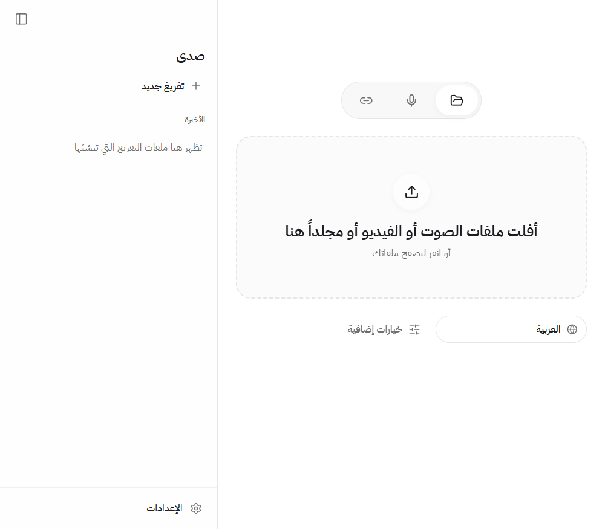

<div align="center" dir="rtl">

# صدى · Sada

**تفريغ صوتي وفيديو إلى نص، عربي أولاً، على جهازك — بدون إنترنت.**

[](https://github.com/alshahia/sada/actions/workflows/ci.yml)
[](https://github.com/alshahia/sada/releases/latest)
[](LICENSE)


[English](README.md) · [التحميل](https://github.com/alshahia/sada/releases/latest) · [الموقع](https://alshahia.github.io/sada/) · [الوثائق](docs/)

</div>

<div dir="rtl">



صدى تطبيق سطح مكتب لنظام Windows يفرّغ الصوت والفيديو إلى نص **على جهازك**، وهو **عربي أولاً**:
يفتح بالعربية ومن اليمين إلى اليسار، بافتراضيات تفريغ عربية، وخط IBM Plex Sans Arabic، وتنظيف
نصوص يراعي العربية. اللغات الأخرى — ومنها الإنجليزية — تبقى متاحة من الإعدادات بنقرة واحدة.

صدى شوكة مستقلة من [Vibe](https://github.com/thewh1teagle/vibe) (رخصة MIT)، مبنية على الإصدار
**v3.2.2**، أُزيلت منها القياسات والتحديث التلقائي ومرحّل الهاتف، وأُضيف تعريب كامل. لا يُرسل
شيء إلى الإنترنت: محرّك Whisper يعمل محلياً عبر `vibe-server`، و`ffmpeg` مضمّن في المثبّت لفك
ترميز الصوت.

ومنذ 3.3.0 أصبح صدى **جاهزاً للوكلاء**: `Sada.exe --mcp` يشغّل خادم MCP محلياً عبر stdio،
فيستطيع Claude Code وCodex وغيرهما تفريغ الصوت العربي وقراءة النصوص المحفوظة مباشرة — بلا منفذ
خادم، بلا حساب، بلا شبكة. انظر [docs/AGENT-MCP.ar.md](docs/AGENT-MCP.ar.md).

- **كلمات مفتاحية:** تفريغ صوتي بدون إنترنت، تفريغ عربي، التعرف على الكلام العربي، whisper.cpp،
  واجهة RTL، الفصحى واللهجة العراقية، تطبيق تفريغ Windows، تصدير SRT/VTT/PDF/DOCX، خادم MCP
  للوكلاء، أدوات وكلاء محلية.

## لماذا صدى؟

معظم تطبيقات التفريغ تتعامل مع العربية كلغة ترجمة لا كلغة أولى. صدى يعكس ذلك:

- **افتراضيات عربية أولاً** — لغة الواجهة `ar-IQ`، لغة التفريغ `ar`، الترجمة معطّلة، حرارة 0،
  beam 5، ستة خيوط، وبادئة تفريغ فارغة.
- **واجهة من اليمين إلى اليسار** — الواجهة والإعدادات والنوافذ وتصدير PDF والرسائل بالعربية،
  والأكرونيمات اللاتينية ومسارات الملفات تبقى معزولة وقابلة للقراءة.
- **تنظيف نص عربي** — تحويل الفواصل الإنجليزية إلى عربية (`,` ← `،`، `?` ← `؟`، `;` ← `؛`)،
  إزالة المسافات الزائدة، واستعادة الأكرونيمات الشائعة (GPU، CPU، PDF، SRT، VTT، JSON، API،
  FFmpeg، Whisper) داخل النص العربي.
- **PDF عربي** — تصدير النص إلى PDF بخط عربي مضمّن وتشكيل صحيح.
- **خصوصية كاملة** — بلا حساب، بلا تحليلات، بلا تقارير أعطال، بلا تحديث تلقائي، بلا مرحّل هاتف.
  لا اتصال شبكي إلا عندما تطلبه أنت (تنزيل نموذج، رابط تلصقه، أو مزوّد تلخيص تُعدّه بمفتاحك).
- **جاهز للوكلاء (MCP)** — `Sada.exe --mcp` يمنح الوكلاء أذناً عربية عبر stdio: تفريغ ملف،
  وسرد النصوص أو قراءتها، وفحص التثبيت. بلا منفذ وبلا مفتاح وبلا نافذة.

## المزايا

| | |
| --- | --- |
| **تفريغ ملفات** | أفلت صوتاً أو فيديو؛ تفريغ دفعات مع تقدّم لكل ملف وإمكانية الإلغاء. |
| **معاينة مباشرة** | شاهد النص يُكتب أثناء المعالجة. |
| **نماذج Whisper** | أي نموذج `ggml-*.bin`؛ نزّله من الإعدادات أو اختر ملفاً محلياً. المقترح للعربية: `large-v3-turbo`. |
| **تصدير** | SRT وVTT وTXT وHTML وPDF (بخط عربي) وDOCX وJSON. |
| **إملاء** | اختصار عام: استمر بالضغط للتسجيل، وأفلت للتفريغ في التطبيق النشط. |
| **تسجيل** | من الميكروفون ومن صوت النظام. |
| **مشاريع** | نصوص محفوظة قابلة للبحث وإعادة الفتح والتصدير. |
| **تلخيص اختياري** | Claude أو Ollama المحلي بمفتاحك — معطّل افتراضياً. |
| **الوكلاء (MCP)** | `Sada.exe --mcp` — أربع أدوات stdio لـ Claude Code وCodex وغيرهما، بافتراضيات عربية ومحلياً فقط. |
| **اللغات** | العربية (`ar-IQ`) مع أكثر من 20 لغة موروثة من المنبع. |

## التثبيت

1. نزّل **`Sada_3.3.1_x64-setup.exe`** من [أحدث إصدار](https://github.com/alshahia/sada/releases/latest)
   وتحقّق من بصمة SHA-256 مقابل ملف `SHA256SUMS.txt` المرفق.
2. شغّل المثبّت. يُثبّت لكل مستخدم في `%LOCALAPPDATA%\Sada\` ولا يحتاج صلاحيات مدير.
3. افتح **صدى** من قائمة ابدأ.

> **تنبيه SmartScreen:** المثبّت غير موقّع رقمياً، فقد يظهر «Windows protected your PC».
> اضغط *More info ← Run anyway* فقط للإصدار الرسمي بعد التحقق من البصمة.

المتطلبات: Windows 10 أو 11 (64-bit)، وWebView2 (مضمّن في Windows الحديث)، ومساحة قرص لنموذج
Whisper.

## أول تشغيل والنماذج

عند أول تشغيل يفتح صدى شاشة إعداد عربية. اختر نموذجاً من **الإعدادات ← النماذج**:

- `large-v3-turbo` (~1.6GB) — أفضل توازن بين جودة العربية والسرعة لمعظم المستخدمين؛
- `medium` أو `small` للأجهزة الأضعف؛
- أو **اختر ملفاً** إذا كان لديك `ggml-*.bin` على القرص.

النماذج **لا تُشحن** مع المثبّت؛ ينشرها أصحابها بشروطهم. تُحمّل محلياً ولا تغادر جهازك أبداً.

## تسريع GPU (اختياري)

يشحن صدى نسخة Vulkan من محرّك whisper.cpp، فيمكن لبطاقة رسومات تدعم Vulkan تسريع التفريغ بلا
CUDA أو ROCm أو أي تنزيل إضافي. GPU **مسرّع اختياري لا شرط**: كل نموذج يبقى يعمل على المعالج.

- **اختيار الجهاز:** **الإعدادات ← النماذج ← العتاد**. «تلقائي» (الافتراضي) يترك المحرّك يختار
  جهاز Vulkan الافتراضي؛ اختر جهازاً محدداً إن كان لديك أكثر من بطاقة. مفتاح **التفريغ على
  المعالج** يفرض مسار CPU.
- **ما تحتاجه:** تعريف بطاقة يوفّر Vulkan 1.1 أو أحدث (تعريفات NVIDIA/AMD/Intel الحالية تفعل ذلك؛
  وإذا لم يكن Vulkan مثبتاً ثبّت
  [Vulkan Runtime](https://sdk.lunarg.com/sdk/download/1.3.290.0/windows/VulkanRT-1.3.290.0-Installer.exe)).
  وعند غياب Vulkan يستخدم المحرّك المعالج بهدوء ولا يرفض التطبيق العمل.
- **نفاد ذاكرة GPU:** إذا فشل تحميل نموذج على البطاقة يعيد صدى المحاولة على المعالج، ويخبرك،
  ويتذكر النموذج فتبدأ التشغيلات التالية على المعالج بدل الفشل مجدداً.
- **السرعة:** على جهاز المرجع (NVIDIA Quadro RTX 4000 بواجهة Vulkan) فُرّغ 38 ثانية صوت عربي في
  نحو 4.9 ثانية شاملة تحميل النموذج (~12.5× الزمن الحقيقي). مسار CPU للتوافق لا للسرعة.
- **التشخيص:** يستطيع المحرّك سرد الأجهزة التي يراها بالأمر
  `vibe-server-x86_64-pc-windows-msvc.exe devices`؛ وانظر [docs/DEBUG.md](docs/DEBUG.md) لأخطاء
  `vulkan-1.dll` و[docs/BUILDING.md](docs/BUILDING.md) لتفاصيل البناء.

## الخصوصية

- بلا تحليلات أو قياسات أو تقارير أعطال أو حساب.
- الصوت والفيديو والنصوص لا تغادر الجهاز.
- `ffmpeg` المضمّن يُستخدم فقط كعملية محلية لفك الترميز.
- الإعدادات والمشاريع في `%APPDATA%\app.sada.desktop\`، والنموذج وملف WebView في
  `%LOCALAPPDATA%\app.sada.desktop\`.

انظر [PRIVACY.md](PRIVACY.md). مكوّن التحديث وAptabase أُزيلا من المصدر لا من التشغيل فقط.

## التحقق من البناء

بُني هذا الإصدار من المصدر في هذا المستودع وتم التحقق منه من طرف إلى طرف:

- 26 ملف اختبار / 134 اختباراً ناجحاً (`pnpm test`، exit 0)، ومنها اختبارات تنظيف النص العربي،
  وتصدير PDF عربي، ولغة واتجاه أول تشغيل.
- فحص محرّك v0.6.16: المقاطع الأربعة أعطت النص نفسه كما في v0.6.10، وأزمنة SRT/VTT صحيحة،
  ونموذج Nemotron-3 للأصوات وسم 12 من 12 شريحة، ومسار CPU فقط يعمل.
- اختبارات Rust: 83 اختباراً ناجحاً (`cargo test --release`)، منها 19 لبروتوكول MCP وأدواته
  و9 للمنظّف العربي.
- تحقق MCP من طرف إلى طرف: `Sada.exe --mcp` أجاب initialize وtools/list وsada_info
  وsada_transcripts وsada_transcript وsada_transcribe عبر الأنابيب بنموذج حقيقي وصوت عربي.
- تحقق أول تشغيل من ملف تعريف نظيف: الواجهة عربية RTL فعلاً (`lang=ar-IQ`، `dir=rtl`)، بفحص
  WebView أثناء التشغيل لا بقراءة المصدر فقط.
- تحقق تفريغ عربي بمحرّك التطبيق نفسه على مقاطع فصحى ولهجة عراقية، ومسار CLI يعيد exit 0.
- فحص الشبكة عند الخمول: اتصالات loopback فقط، بلا أي نقطة خارجية.
- القيود المعروفة في [docs/VERIFICATION.md](docs/VERIFICATION.md).

## البناء من المصدر

المتطلبات: [Rust](https://rustup.rs)، Node.js 22+، pnpm 10.4.1 (corepack)، [chore](https://getchore.github.io/chore/).

```powershell
git clone https://github.com/alshahia/sada.git
cd sada
chore setup x86_64-pc-windows-msvc   # ينزّل sidecars المثبّتة: vibe-server + ffmpeg
cd desktop
pnpm install
pnpm test
pnpm exec tauri build                # ينتج مثبّت NSIS تحت target/release/bundle/nsis/
```

ملفات sidecar لا تُرفع إلى git (مجموعها ~175MB)؛ ينزّلها `chore setup` من إصدار الخادم المثبّت في
[.server-version](.server-version). التفاصيل في [docs/BUILDING.md](docs/BUILDING.md).

## بنية المستودع

```text
desktop/          تطبيق Tauri 2 + React 19 (الواجهة، قشرة Rust، الأيقونات، الخطوط)
i18n/desktop/     ملفات الترجمة، ومنها ar-IQ.json (704 مفاتيح)
server/           vibe-server: sidecar Rust حول whisper.cpp (محرّك المنبع)
docs/             العمارة، البناء، التحقق، التراخيص، ملاحظات الإصدارات، دليل MCP، مراجعة Voicebox
site/             صفحة هبوط ثابتة ثنائية اللغة (GitHub Pages، مع llms.txt للوكلاء)
.github/workflows CI (بناء واختبارات)، Release (وسم → مثبّت Windows وإصدار GitHub)، Deploy site
```

## أسئلة شائعة

<details>
<summary><strong>هل صدى مجاني؟</strong></summary>
نعم. المصدر برخصة MIT، ومثبّت Windows مجاني. بلا حساب وبلا اشتراك.
</details>

<details>
<summary><strong>هل يعمل بدون إنترنت؟</strong></summary>
نعم، بعد تنزيل النموذج مرة واحدة. التفريغ محلي بالكامل، والشبكة لا تُستخدم إلا لما تطلبه صراحة.
</details>

<details>
<summary><strong>هل يستطيع وكلاء الذكاء الاصطناعي استخدام صدى؟</strong></summary>
نعم. `Sada.exe --mcp` خادم MCP محلي عبر stdio وفيه أربع أدوات: تفريغ ملف، وسرد النصوص
المحفوظة، وقراءة نص، وتقرير عن التثبيت. سجّله في Claude Code بالأمر
`claude mcp add sada -- ".../Sada.exe" --mcp` أو في أي عميل MCP بإعداد JSON. محلي فقط:
بلا منفذ وبلا حساب وبلا شبكة. انظر [docs/AGENT-MCP.ar.md](docs/AGENT-MCP.ar.md).
</details>

<details>
<summary><strong>هل يدعم اللهجة العراقية؟</strong></summary>
Whisper يتعامل مع العراقية ضمن العربية. التنظيف العربي يوحّد علامات الترقيم، ودقة اللهجة تعتمد
على النموذج وجودة الصوت. ابدأ بـ `large-v3-turbo`.
</details>

<details>
<summary><strong>ما الفرق عن Vibe؟</strong></summary>
صدى شوكة: تعريب كامل وRTL، افتراضيات عربية، تنظيف نص عربي، تصدير PDF عربي، اسم وأيقونة جديدة،
وإزالة القياسات والتحديث التلقائي ومرحّل الهاتف. محرّك التفريغ كود المنبع. التفاصيل في
[docs/UPSTREAM-PATCHES.md](docs/UPSTREAM-PATCHES.md).
</details>

<details>
<summary><strong>لماذا يحذر Windows من المثبّت؟</strong></summary>
المثبّت غير موقّع رقمياً (شهادات توقيع الكود مكلّفة). تحقّق من بصمة SHA-256، أو ابنِ من المصدر.
</details>

<details>
<summary><strong>أين ملفاتي؟</strong></summary>
الإعدادات والسجلات والمشاريع: `%APPDATA%\app.sada.desktop\`. النموذج وبيانات WebView:
`%LOCALAPPDATA%\app.sada.desktop\`. لا شيء يُنسخ خارجها.
</details>

## المساهمة

المشكلات وطلبات الدمج مرحّب بها — انظر [CONTRIBUTING.md](CONTRIBUTING.md). للإبلاغ الأمني استخدم
GitHub Security Advisories، انظر [SECURITY.md](SECURITY.md).

## الترخيص والإسناد

MIT — انظر [LICENSE](LICENSE). حقوق مؤلف Vibe الأصلية محفوظة. صدى شوكة مستقلة، **غير مرتبطة
بمؤلف Vibe ولا معتمدة منه**؛ «Vibe» ملك مؤلفه، واسم صدى وأيقونتها من عمل هذه الشوكة.

المثبّت يضم **FFmpeg 9.0.1** بترخيص GPLv3؛ اقرأ [THIRD-PARTY-NOTICES.md](THIRD-PARTY-NOTICES.md)
قبل إعادة توزيع أي بناء. خط IBM Plex Sans Arabic برخصة SIL OFL 1.1. الإشعارات الكاملة والنصوص:
[NOTICE](NOTICE)، [docs/licenses/](docs/licenses/).

---

<sub>صدى — تفريغ صوتي عربي على جهازك، بلا إنترنت. Arabic-first offline transcription for Windows.</sub>

</div>
