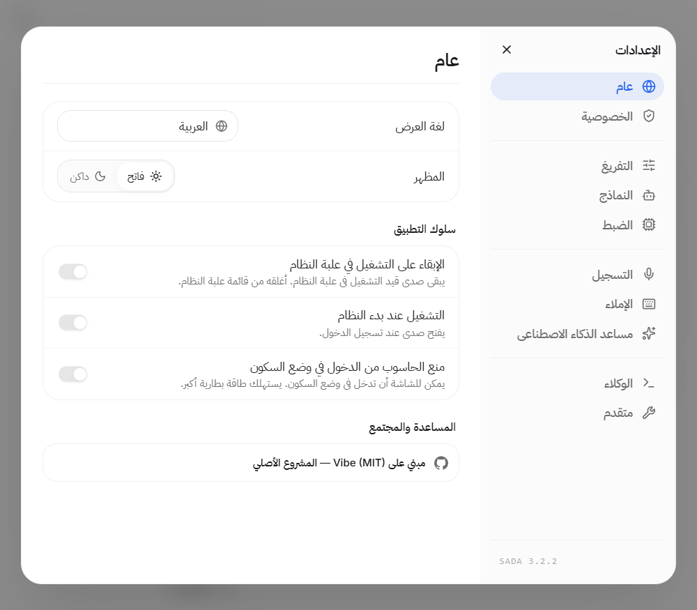
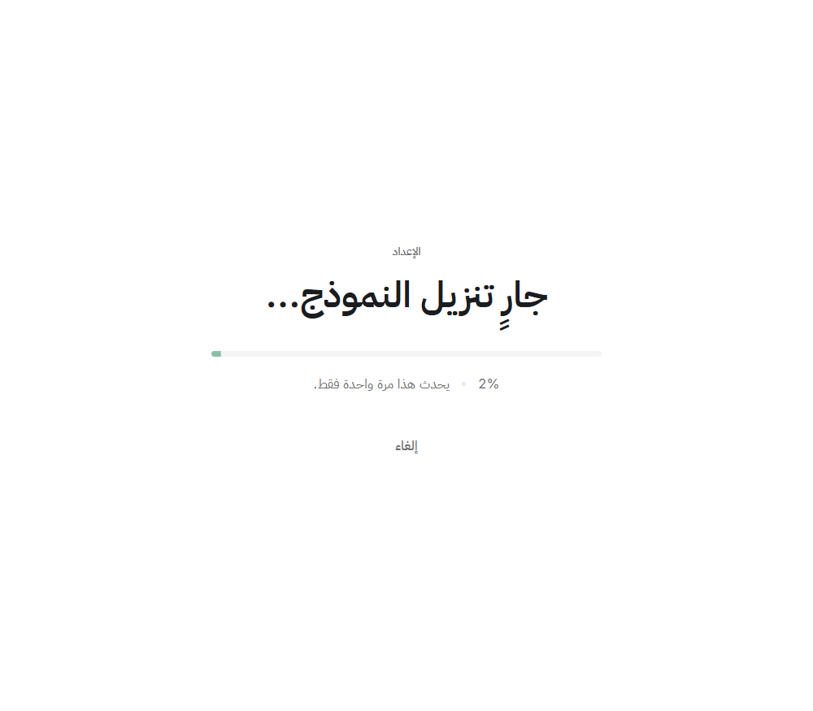

<!--
  الملف العربي المقابل لـ README.md — حافظ على تزامن الحقائق بين الملفين
  (الإصدار، الأرقام، قائمة النماذج، الروابط).
-->

<div align="center" dir="rtl">

# صدى · Sada

**تفريغ صوتي عربي إلى نص على ويندوز — مجاني وخاص ويعمل بلا إنترنت بالكامل.**

[](https://github.com/alshahia/sada/actions/workflows/ci.yml)
[](https://github.com/alshahia/sada/releases/latest)


[English (الإنجليزية)](README.md) · [التحميل](https://github.com/alshahia/sada/releases/latest) · [الموقع](https://alshahia.github.io/sada/) · [الوثائق](#الوثائق) · [التحقق من الإصدار](#البناء-المتحقق-منه-وأدلة-الإصدار)

</div>

<div dir="rtl">

صدى (ومعناه "الصوت المرتد") يحوّل الصوت والفيديو العربي إلى نص **على جهاز الكمبيوتر الخاص بك**،
بلا حساب، وبلا رفع إلى السحابة، وبلا قياسات. أفلت ملفاً واحصل على نص أو ترجمة أو PDF بتنسيق عربي؛
ويفتح التطبيق بالعربية ومن اليمين إلى اليسار افتراضياً، والإنجليزية وبقية اللغات الموروثة على بعد
نقرة واحدة. التطبيق مجاني برخصة MIT، ويعمل بعد تنزيل النموذج مرة واحدة حتى مع فصل كابل الشبكة.

صدى شوكة مستقلة من [Vibe](https://github.com/thewh1teagle/vibe) (رخصة MIT) مبنية على الإصدار
**v3.2.2**، أُزيلت منها القياسات والتحديث التلقائي ونقل الهاتف، وأُضيف تعريب كامل، ومنذ 3.3.0
أُضيف خادم MCP محلي ليتمكن وكلاء الذكاء الاصطناعي من استخدامه بلا منفذ وبلا حساب.

> **الجديد في 3.10.0:** أول إصدار يعالج تقييم واجهة 3.9.0 — نافذة أخطاء تُصلح المشكلة بدل أن تكتفي
> بالاعتذار، وزر «نسخ الكل» وتصدير مُجمَّع بأربع مجموعات، وإعدادات كنافذة من ترويسة التطبيق، وإصلاح
> تتبّع الحروف العربية واتجاه الأرقام، ونصوص ثقة تقول ما يمكن إثباته فقط. واختُبرت الإتاحة وقت
> التشغيل: 35 حالة، 0 مخالفة axe. انظر [ملاحظات الإصدار](https://github.com/alshahia/sada/releases/tag/v3.10.0).

## لماذا صدى عربي أولاً؟

معظم أدوات التفريغ تتعامل مع العربية كلغة ترجمة أو كإضافة متأخرة. صدى مبني بالعكس:

- **افتراضيات عربية لا إنجليزية.** تبدأ الواجهة بـ `ar-IQ`، والتفريغ بـ `ar`، والترجمة
  معطّلة، والحرارة 0، وbeam 5، وستة خيوط، وبادئة تفريغ فارغة.
- **واجهة RTL حقيقية.** الواجهة والإعدادات والنوافذ وتصدير PDF ورسائل الأخطاء بالعربية ومن اليمين
  إلى اليسار؛ والأكرونيمات اللاتينية ومسارات الملفات والأرقام تبقى معزولة وقابلة للقراءة.
- **تنظيف نص يراعي العربية.** تتحول علامات الترقيم الإنجليزية إلى عربية (`, → ،`، `? → ؟`،
  `; → ؛`)، وتُزال المسافات الزائدة، وتُستعاد الأكرونيمات الشائعة (GPU، CPU، PDF، SRT، VTT،
  JSON، API، FFmpeg، Whisper) داخل النص العربي.
- **تصدير PDF عربي.** تُصدَّر النصوص إلى PDF بخط عربي مضمّن وتشكيل صحيح، لا مربعات ولا حروف مقطّعة.
- **جودة مقاسة لا مُفترضة.** قائمة النماذج مدعومة بمنظومة قياس عربية محفوظة في المستودع (انظر
  [الجودة](#جودة-التفريغ-العربي-مقاسة))، والافتراضي هو النموذج الذي فاز فعلاً في قياس WER العربي
  والاحتفاظ بالأسماء اللاتينية والأزمنة.

## لمن صُمّم صدى؟

- للمحرّرين وصنّاع المحتوى الذين يحتاجون ترجمة عربية (SRT/VTT) أو نصاً مقروءاً دون رفع مواد
  العملاء.
- للباحثين والصحفيين والطلاب الذين يفرّغون مقابلات ومحاضرات واجتماعات لا يمكن أن تغادر الجهاز.
- للفرق التي تعمل على شبكات مقيدة أو متقطعة، وللمؤسسات التي تفرض قيوداً على مكان البيانات.
- للمستخدم العربي الذي يريد إملاءً أو تفريغ ملفات دون اشتراك.
- للمطورين الذين يحتاجون تعرّفاً صوتياً عربياً محلياً للوكلاء والخطوط الآلية عبر خادم MCP المدمج.

## المزايا

| | |
| --- | --- |
| **تفريغ الملفات** | أفلت ملف صوت أو فيديو؛ تفريغ دفعات مع تقدّم لكل ملف وإمكانية الإلغاء. |
| **معاينة مباشرة** | شاهد النص يُكتب أثناء معالجة الملف. |
| **نماذج Whisper** | أي نموذج `ggml-*.bin`؛ نزّله من الإعدادات أو اختر ملفاً محلياً. المقترح للعربية: `large-v3-turbo`. |
| **التصدير** | SRT وVTT وTXT وHTML وPDF (بخط عربي مضمّن) وDOCX وJSON. |
| **الإملاء** | اختصار عام: استمر بالضغط للتسجيل، وأفلت للتفريغ في التطبيق النشط. |
| **التسجيل** | من الميكروفون ومن صوت النظام. |
| **المشاريع** | نصوص محفوظة مع بحث وإعادة فتح وإعادة تصدير. |
| **تلخيص اختياري** | Claude أو نموذج Ollama المحلي بمفتاحك — معطّل افتراضياً. |
| **الوكلاء (MCP)** | `Sada.exe --mcp` يوفر أربع أدوات stdio لـ Claude Code وCodex وغيرهما؛ افتراضيات عربية ومحلي فقط. |
| **اللغات** | العربية (`ar-IQ`) مع 22 لغة واجهة موروثة؛ والتفريغ يشمل لغات المحرّك المدعومة. |
| **تسريع GPU** | مسار Vulkan اختياري، مع رجوع تلقائي إلى المعالج عندما لا يتسع النموذج للبطاقة. |
| **ضوابط الإدارة** | سياسة جهاز تفرض عدم الاتصال، ومفاتيح API مختومة بـ DPAPI، وسياسة احتفاظ بالنصوص. |

## لقطات الشاشة


| الإعدادات والنماذج | شاشة أول تشغيل عربية |
| --- | --- |
|  |  |

## التنزيل والتثبيت (Windows 10/11 x64)

### المثبّت القياسي (المستحسن)

1. نزّل **`Sada_3.10.0_x64-setup.exe`** (نحو 45 ميغابايت) من
   [أحدث إصدار](https://github.com/alshahia/sada/releases/latest).
2. تحقّق منه (مستحسن — انظر [التحقق من التنزيل](#التحقق-من-التنزيل)).
3. شغّل المثبّت. يُثبّت لكل مستخدم في `%LOCALAPPDATA%\Sada\` ولا يحتاج صلاحيات مدير.
4. افتح **صدى** من قائمة ابدأ.

### المثبّت الذي يعمل بلا إنترنت

جهاز Windows 10 الذي لم يشغّل تطبيقاً حديثاً لا يحتوي WebView2، والمثبّت القياسي يطلب من Windows
تنزيله. إذا تعذّر اتصال الجهاز بالشبكة، نزّل **`Sada_3.10.0_x64-setup-offline.exe`**
(نحو 250 ميغابايت) بدلاً منه: يضمّن مثبّت WebView2، فيكفي ملف واحد للتطبيق والواجهة.

لا يضمّ أي من الملفين حزمة VC++ 2015-2022؛ يثبّتها المثبّت من مايكروسوفت عند نقصها، فعلى جهاز
بلا إنترنت نهائياً تثبيت `vc_redist.x64.exe` مسبقاً (أو تثبيت WebView2 أولاً فهو يجلب
متطلباته).

### مثبّت MSI لكل الجهاز (للإدارة المؤسسية)

يصدر v3.10.0 أيضاً **`Sada_3.10.0_x64_en-US.msi`**، مثبّت WiX لكل الجهاز مناسب لـ
Intune/SCCM/GPO (يحتاج صلاحيات مدير)، مع سياسة على مستوى الجهاز تفرض وضع عدم الاتصال وتعطّل
الذكاء الاصطناعي واستيراد الروابط وتنزيل النماذج. التثبيت الصامت والاكتشاف والسياسة والتنظيف
موثّقة في [docs/ENTERPRISE-DEPLOYMENT.md](docs/ENTERPRISE-DEPLOYMENT.md).

### التحقق من التنزيل

كل إصدار ينشر `SHA256SUMS.txt` وبصمة بناء بلا مفاتيح (Sigstore) وحزمة SBOM بصيغة
CycloneDX. باختصار:

```powershell
# 1. بصمة SHA-256 مقابل القيمة المنشورة
Get-FileHash .\Sada_3.10.0_x64-setup.exe -Algorithm SHA256

# 2. بصمة البناء — يتحقق GitHub CLI من التوقيع وهوية سير العمل
gh attestation verify .\Sada_3.10.0_x64-setup.exe --repo alshahia/sada

# ...أو تحقّق من كل أصول الإصدار وبصماتها بأمر واحد
pwsh -File scripts/verify-release.ps1 -Version 3.10.0 -Download
```

التفاصيل الكاملة: [docs/SUPPLY-CHAIN.md](docs/SUPPLY-CHAIN.md) و
[docs/VERIFICATION.md](docs/VERIFICATION.md).

> **تنبيه SmartScreen:** المثبّت غير موقّع رقمياً بعد (قرار المالك ما دام المشروع مفتوح المصدر
> فقط)، فقد يظهر *"Windows protected your PC"*. اضغط *More info ← Run anyway* فقط للإصدار
> الرسمي بعد التحقق من البصمة وبصمة البناء. مسار التوقيع جاهز وسيُفعَّل عندما يتقدم المشروع
> بطلبه — انظر [docs/SIGNING.md](docs/SIGNING.md).

### المتطلبات

- Windows 10 أو Windows 11، 64-bit (x64).
- WebView2 Runtime (مضمّن في Windows الحديث؛ والمثبّت غير المتصل يضمّنه).
- حزمة VC++ 2015-2022 (تُثبَّت تلقائياً عند الاتصال).
- مساحة قرص لنموذج Whisper — نحو 1.6 غيغابايت للنموذج الموصى به (النماذج غير مضمّنة).

## أول تشغيل: اختر نموذجاً

عند أول تشغيل يفتح صدى شاشة إعداد عربية. افتح **الإعدادات ← النماذج ← الحصول على النماذج**.
القائمة تأتي داخل التطبيق، لذا تعمل على تثبيت جديد بلا إنترنت، ويُفحص كل تنزيل مقابل بصمة
SHA-256 في القائمة قبل استخدامه:

| النموذج | الحجم | الترخيص | لماذا تختاره |
| --- | ---: | --- | --- |
| **Whisper Large v3 Turbo** — الافتراضي | 1.62 غيغابايت | MIT | أفضل توازن عربي مقاس: WER ‏19.46%، وأزمنة على مستوى الكلمة، ويحفظ ربع الأسماء اللاتينية. |
| **Whisper Tiny** | 78 ميغابايت | MIT | يعمل على الأجهزة البطيئة جداً بدقة أقل (احتياطي فقط). |
| **NVIDIA Nemotron 3.5 ASR Streaming 0.6B** — اختياري | 496 ميغابايت | OpenMDW-1.1 | إملاء أسرع وWER أقل على الفصحى والمصرية، لكنه ينقل الألفاظ اللاتينية صوتياً؛ ليس الافتراضي. |
| **Whisper Large v3 Turbo Hebrew** | 1.62 غيغابايت | Apache-2.0 | للصوت العبري (ivrit.ai). |

يمكنك أيضاً **إضافة نموذج…** للإشارة إلى أي ملف `ggml-*.bin` محلي. تُنزَّل النماذج مرة
واحدة وتُحمَّل محلياً ولا تغادر الجهاز. الأحجام والبصمات وملاحظات GPU وخطوات التحقق:
[docs/MODELS.md](docs/MODELS.md). المقارنة المقاسة وراء القائمة:
[docs/MODELS-DECISIONS.md](docs/MODELS-DECISIONS.md).

## جودة التفريغ العربي (مقاسة)

لا تُقاس جودة صدى بالانطباع. المستودع يضم منظومة قياس عربية بلغة Python
(`benchmarks/arabic-asr/`) تجلب مجموعات صوتية متوافقة الترخيص مرة واحدة، وتوحّد النص
العربي، وتحسب WER/CER على مستوى المجموعة، والاحتفاظ بالأسماء اللاتينية، وتغطية الأزمنة على
مستوى الكلمة. النتائج على 60 مقطعاً من **Common Voice 18 Arabic** (30 فصحى + 10 قراءة مختلطة
باللاتينية) و**FLEURS ar_eg** (20 مقطعاً مصرياً)، ببطاقة Vulkan في 2026-11-18، على المحرّك
`vibe-server v0.6.16-sada.1`:

| النموذج | WER % ↓ | CER % ↓ | الأسماء اللاتينية المحفوظة % ↑ | الأزمنة % | RTF ↓ |
| --- | ---: | ---: | ---: | ---: | ---: |
| **whisper-large-v3-turbo** (الافتراضي) | 19.46 | 8.34 | **25.0** | 100.0 | 0.35 |
| nemotron-3.5-asr-streaming-0.6b | **17.12** | 8.28 | 0.0 | 100.0 | **0.234** |
| whisper-large-v3-turbo-arabic-dialectal-v2-q5 | 23.09 | 9.53 | 0.0 | 100.0 | 0.265 |
| whisper-tiny | 70.56 | 29.46 | 0.0 | 100.0 | 0.186 |

الأقل أفضل في WER/CER/RTF، والأعلى أفضل في الاحتفاظ بالأسماء اللاتينية. WER حسب الشريحة:
الفصحى 22.09 / المصرية 11.03 / المختلطة باللاتينية 48.96 في Turbo؛ وNemotron
17.83 / 9.11 / 50.00. **لم يُقس بعد، ولا ندّعيه:** اللهجات العراقية والخليجية والشامية تحتاج
مجموعة صوتية بترخيص يسمح بالاستخدام التجاري، ولم يجدها المشروع؛ وهذه الفجوة مسجّلة لا مخفية.
النتائج الخام والمنظومة: [`benchmarks/arabic-asr/`](benchmarks/arabic-asr/).

## استخدام صدى من وكيل ذكاء اصطناعي (MCP)

`Sada.exe --mcp` يشغّل خادم MCP محلياً عبر stdio — بلا منفذ، وبلا حساب، وبلا شبكة. أربع
أدوات: `sada_transcribe` (تفريغ ملف)، و`sada_transcripts` (سرد النصوص المحفوظة)،
و`sada_transcript` (قراءة نص)، و`sada_info` (معلومات التثبيت والنماذج).

```powershell
claude mcp add sada -- "C:\Users\<you>\AppData\Local\Sada\Sada.exe" --mcp
```

ويمكن لأي عميل MCP استخدام الإعداد المكافئ بصيغة JSON:

```json
{
  "mcpServers": {
    "sada": {
      "command": "C:\\Users\\<you>\\AppData\\Local\\Sada\\Sada.exe",
      "args": ["--mcp"]
    }
  }
}
```

انظر [docs/AGENT-MCP.ar.md](docs/AGENT-MCP.ar.md) لمخططات الأدوات والحدود والأمثلة بالعربية
والإنجليزية.

## تسريع المعالج الرسومي (اختياري)

يشحن صدى نسخة Vulkan من محرّك whisper.cpp؛ بطاقة تدعم Vulkan 1.1+ (تعريفات NVIDIA/AMD/Intel
الحالية) تسرّع التفريغ بلا CUDA أو ROCm. GPU مسرّع اختياري: كل نموذج يبقى يعمل على المعالج،
والتطبيق لا يرفض العمل بلا Vulkan.

- **الإعدادات ← النماذج ← العتاد** تعرض *تلقائي* أو جهاز Vulkan محدداً أو *التفريغ على المعالج*.
- إذا فشل تحميل النموذج على البطاقة يعيد صدى المحاولة على المعالج، ويخبرك، ويتذكر النموذج
  فتبدأ التشغيلات التالية على المعالج بدل الفشل مجدداً.
- سرعة مرجعية: على NVIDIA Quadro RTX 4000 بواجهة Vulkan، فُرّغ 38 ثانية صوت عربي في نحو 4.9
  ثانية شاملة تحميل النموذج (~12.5× الزمن الحقيقي).
- التشخيص: `vibe-server-x86_64-pc-windows-msvc.exe devices`؛ واستكشاف الأخطاء في
  [docs/DEBUG.md](docs/DEBUG.md) و[بدء البناء](docs/BUILDING.md).

## النشر المؤسسي والإدارة

يضيف v3.9.0 الضوابط التي تحتاجها بيئة Windows مُدارة، دون أي مكوّن خادم:

- **مثبّت MSI لكل الجهاز** لـ Intune/SCCM/GPO، مع عدة قبول على جهاز نظيف.
- **سياسة مُدارة** في `HKLM\SOFTWARE\Sada\Policy` (أو `%ProgramData%\Sada\policy.json`)
  تفرض وضع عدم الاتصال وتعطّل الذكاء الاصطناعي واستيراد الروابط وتنزيل النماذج؛ مطبّقة في طبقة
  أوامر Rust لا مخفية في الواجهة فقط.
- **مفاتيح API مختومة بـ DPAPI**، و**سياسة احتفاظ/تطهير للنصوص**، و**جرد حركة الشبكة الصادرة**.
- **سلسلة توريد بلا مفاتيح:** بصمات بناء، وحزمة SBOM بصيغة CycloneDX (1,939 مكوّناً)، وسكربت
  `scripts/verify-release.ps1`.

ابدأ من [docs/ENTERPRISE-DEPLOYMENT.md](docs/ENTERPRISE-DEPLOYMENT.md)؛ ومادة السياسة والشبكة
والأمن والمشتريات مدرجة تحت [الوثائق](#الوثائق).

## الخصوصية والشبكة

- بلا تحليلات أو قياسات أو تقارير أعطال أو حساب أو تحديث تلقائي.
- الصوت والفيديو والنصوص لا تغادر الجهاز.
- الشبكة لا تُستخدم إلا لأفعال *تبدأها أنت*: تنزيل نموذج، أو استيراد من رابط وسائط عبر yt-dlp،
  أو مزوّد تلخيص تُعدّه بمفتاحك — وسياسة الإدارة تستطيع منعها كلها.
- FFmpeg المضمّن يعمل كعملية محلية لفك الترميز فقط.
- الإعدادات والمشاريع في `%APPDATA%\app.sada.desktop\`؛ والنموذج وملف WebView في
  `%LOCALAPPDATA%\app.sada.desktop\`.

انظر [PRIVACY.md](PRIVACY.md) وجرد الحركة الصادرة الكامل في [docs/NETWORK.ar.md](docs/NETWORK.ar.md).
أُزيل مكوّن التحديث وAptabase من المصدر لا من التشغيل فقط.

## البناء المتحقق منه وأدلة الإصدار

كل إصدار يُبنى من هذا المستودع عبر GitHub Actions ثم يُتحقق منه من طرف إلى طرف:

- 34 ملف اختبار واجهة / 207 اختبارات، و120 اختبار Rust، و8 اختبارات لحارس المحرّك، و62 اختبار
  Python للقياس تنجح في CI؛ و`tsc` وبناء الإنتاج نظيفان.
- سير إصدار v3.9.0 بنى المحرّك من `server/`، ثم مثبّت NSIS المحمي للاستخدام بلا إنترنت،
  ومثبّت MSI لكل الجهاز، ومثبّت NSIS الافتراضي، وأنشأ حزمة SBOM، ووقّع بصمات بناء لكل أصل.
- أُعيد تنزيل الأصول المنشورة وفحصها بـ `scripts/verify-release.ps1`: بصمة SHA-256 مطابقة،
  و`gh attestation verify` ناجح، والمثبّتان يُثبّتان ويشتغلان بالإصدار والمحرّك المتوقعين.
- تحقق التفريغ العربي وبروتوكول MCP وأول تشغيل بعربية RTL وسلوك الشبكة في الخمول بمحرّك التطبيق
  نفسه ونموذج حقيقي.

الأدلة: [docs/VERIFICATION.md](docs/VERIFICATION.md) · [مصفوفة القبول](docs/ACCEPTANCE.md) ·
[بيان الجاهزية للإنتاج](docs/PRODUCTION-READINESS.md) ·
[إصدار v3.10.0](https://github.com/alshahia/sada/releases/tag/v3.10.0).

## مقارنة سريعة

| | خدمات التفريغ السحابية | Vibe المنبع (v3.2.2) | **صدى** |
| --- | --- | --- | --- |
| مغادرة الصوت للجهاز | نعم، بحكم التصميم | لا | **لا** |
| حساب / اشتراك | عادةً | لا | **لا** |
| العمل بلا إنترنت | لا | نعم بعد تنزيل نموذج | **نعم بعد تنزيل نموذج** |
| واجهة وافتراضيات عربية أولاً | نادراً | لا (إنجليزية أولاً) | **نعم (ar-IQ وRTL وPDF عربي)** |
| القياسات والتحديث التلقائي | عادةً | موجودة في المنبع | **أُزيلت من المصدر** |
| السعر | اشتراك | مجاني (MIT) | **مجاني (MIT)** |
| وصول الوكلاء | API خاص بالمزوّد | — | **خادم MCP محلي** |

المقارنة تصف تصميم كل مشروع لا حكماً بأن الخدمات السحابية سيئة؛ الخدمات السحابية أنسب عندما
تحتاج توسعاً مرناً أو لغات كثيرة أو بنية فريق مشتركة.

## الوثائق

| ابدأ هنا | النماذج والجودة | الخصوصية والأمن | المؤسسات | التطوير |
| --- | --- | --- | --- | --- |
| [التثبيت وأول تشغيل](README.ar.md#أول-تشغيل-اختر-نموذجاً) | [النماذج والبصمات](docs/MODELS.ar.md) | [سياسة الخصوصية](PRIVACY.md) | [النشر المؤسسي](docs/ENTERPRISE-DEPLOYMENT.md) | [البناء من المصدر](docs/BUILDING.md) |
| [دليل الوكلاء/MCP](docs/AGENT-MCP.ar.md) | [قرارات النماذج](docs/MODELS-DECISIONS.md) | [حركة الشبكة](docs/NETWORK.ar.md) | [السياسة والشبكة](docs/NETWORK.ar.md) | [البنية](docs/ARCHITECTURE.md) |
| [تقرير التحقق](docs/VERIFICATION.md) | [القياس العربي](benchmarks/arabic-asr/) | [الورقة الأمنية](docs/SECURITY-WHITEPAPER.md) | [سلسلة التوريد](docs/SUPPLY-CHAIN.md) | [باتشات المنبع](docs/UPSTREAM-PATCHES.md) |
| [ملاحظات الإصدار](docs/releases/v3.10.0.md) | [ملاحظات GPU](docs/DEBUG.md) | [نموذج التهديدات](docs/THREAT-MODEL.md) | [خطة التوقيع](docs/SIGNING.md) | [المساهمة](CONTRIBUTING.md) |

مادة للمشرفين: [خطة الظهور والتحسين لمحركات البحث](docs/DISCOVERABILITY.md)، و[دليل التحقق من الإصدار](docs/VALIDATION-RUNBOOK.md)، و[مصفوفة القبول](docs/ACCEPTANCE.md)، و[مراجعة الواجهة وتجربة الاستخدام](docs/UI-UX-REVIEW.md).

التوثيق الإنجليزي: [README.md](README.md)، و[Network](docs/NETWORK.md)، و[models](docs/MODELS.md)،
و[MCP](docs/AGENT-MCP.md).

## البناء من المصدر

المتطلبات: [Rust](https://rustup.rs)، Node.js 22+، pnpm 10.4.1 (corepack)، و
[chore](https://getchore.github.io/chore/).

```powershell
git clone https://github.com/alshahia/sada.git
cd sada
chore setup x86_64-pc-windows-msvc   # ينزّل sidecars المثبّتة: vibe-server + ffmpeg
cd desktop
pnpm install
pnpm test
pnpm exec tauri build                # ينتج مثبّت NSIS تحت target/release/bundle/nsis/
```

ملفات sidecar لا تُرفع إلى git (مجموعها ~175 ميغابايت)؛ ينزّلها `chore setup` من إصدار
الخادم المثبّت في [.server-version](.server-version). التفاصيل وتعليمات غير ويندوز في
[docs/BUILDING.md](docs/BUILDING.md).

## بنية المستودع

```text
desktop/          تطبيق Tauri 2 + React 19 (الواجهة، قشرة Rust، الأيقونات، الخطوط)
i18n/desktop/     ملفات الترجمة، ومنها ar-IQ.json (748 مفتاحاً)
server/           vibe-server: sidecar Rust حول whisper.cpp (محرّك المنبع)
benchmarks/       منظومة القياس العربي ونتائجها المحفوظة
docs/             العمارة والبناء والتحقق والتراخيص وملاحظات الإصدارات وMCP وحزمة الضمان
site/             صفحة هبوط ثابتة ثنائية اللغة (GitHub Pages، مع llms.txt للوكلاء)
scripts/          التحقق من الإصدار وتوليد SBOM وسكربتات المؤسسات والقبول
.github/workflows CI (بناء واختبارات)، Release (وسم → مثبّتات وبصمات)، Security، Deploy site
```

## الأسئلة الشائعة

<details>
<summary><strong>هل صدى مجاني؟</strong></summary>
نعم. المصدر برخصة MIT والمثبّت مجاني — بلا حساب وبلا اشتراك وبلا إعلانات.
</details>

<details>
<summary><strong>هل يعمل بدون إنترنت؟</strong></summary>
نعم، بعد تنزيل النموذج مرة واحدة. التفريغ محلي بالكامل، والشبكة لا تُستخدم إلا لأفعال تطلبها
صراحة.
</details>

<details>
<summary><strong>ما متطلبات التشغيل؟</strong></summary>
Windows 10 أو 11 (64-bit)، وWebView2 Runtime، وحزمة VC++ 2015-2022، ومساحة قرص لنموذج Whisper
(~1.6 غيغابايت للموصى به). المثبّت غير المتصل يضمّن WebView2.
</details>

<details>
<summary><strong>هل أحتاج بطاقة رسومات؟</strong></summary>
لا. GPU مسرّع Vulkan اختياري؛ كل نموذج يعمل على المعالج، ويعيد صدى المحاولة على المعالج تلقائياً
عندما لا يتسع النموذج للبطاقة.
</details>

<details>
<summary><strong>هل يدعم اللهجة العراقية؟</strong></summary>
Whisper يتعامل مع العراقية ضمن العربية، والتنظيف العربي يوحّد علامات الترقيم. الدقة تعتمد على
النموذج والصوت؛ و`large-v3-turbo` نقطة البداية الموصى بها. لا يوجد بعد قياس منشور للهجة
العراقية لعدم توفر مجموعة صوتية بترخيص يسمح بالاستخدام التجاري — وهذه الفجوة مسجّلة لا مخفية.
</details>

<details>
<summary><strong>ما اللغات المدعومة؟</strong></summary>
العربية (`ar-IQ`) لغة أولى؛ والواجهة تضم 22 لغة موروثة، والتفريغ يشمل لغات محرّك Whisper
المدعومة. والإنجليزية على بعد نقرة واحدة.
</details>

<details>
<summary><strong>ما صيغ التصدير المتاحة؟</strong></summary>
SRT وVTT وTXT وHTML وPDF (بخط عربي مضمّن) وDOCX وJSON.
</details>

<details>
<summary><strong>هل يستطيع وكلاء الذكاء الاصطناعي استخدام صدى؟</strong></summary>
نعم. `Sada.exe --mcp` خادم MCP محلي عبر stdio وفيه أربع أدوات: تفريغ ملف، وسرد النصوص
المحفوظة، وقراءة نص، وتقرير عن التثبيت. سجّله في Claude Code بالأمر
`claude mcp add sada -- "...\Sada.exe" --mcp` أو في إعداد JSON لأي عميل MCP. محلي فقط:
بلا منفذ وبلا حساب وبلا شبكة.
</details>

<details>
<summary><strong>ما الفرق عن Vibe؟</strong></summary>
صدى شوكة من Vibe v3.2.2: تعريب كامل وRTL وافتراضيات عربية وتنظيف نص عربي وتصدير PDF عربي واسم
وأيقونة جديدة، مع إزالة القياسات والتحديث التلقائي ونقل الهاتف. محرّك التفريغ كود المنبع؛
والبانشات مسرودة في [docs/UPSTREAM-PATCHES.md](docs/UPSTREAM-PATCHES.md).
</details>

<details>
<summary><strong>لماذا يحذّر Windows من المثبّت؟</strong></summary>
المثبّت غير موقّع رقمياً بعد (شهادات توقيع الكود مكلّفة). تحقّق من بصمة SHA-256 وبصمة البناء،
أو ابنِ من المصدر. التوقيع جاهز ولم يُفعّل — انظر [docs/SIGNING.md](docs/SIGNING.md).
</details>

<details>
<summary><strong>أين تُحفظ ملفاتي؟</strong></summary>
الإعدادات والسجلات والمشاريع: `%APPDATA%\app.sada.desktop\`. النموذج وبيانات WebView:
`%LOCALAPPDATA%\app.sada.desktop\`. لا شيء يُنسخ خارجها.
</details>

<details>
<summary><strong>هل الاستخدام التجاري مسموح؟</strong></summary>
نعم — رخصة MIT تسمح بالاستخدام التجاري للمصدر. المثبّت يضم FFmpeg 9.0.2 بترخيص GPLv3؛ اقرأ
[THIRD-PARTY-NOTICES.md](THIRD-PARTY-NOTICES.md) قبل إعادة توزيع أي بناء.
</details>

## المساهمة

المشكلات وطلبات الدمج مرحّب بها — انظر [CONTRIBUTING.md](CONTRIBUTING.md). وللإبلاغ الأمني استخدم
GitHub Security Advisories كما في [SECURITY.md](SECURITY.md). وإن كان صدى يوفّر وقتك، فنجمة على
المستودع تساعد مستخدمي العربية على إيجاده:
[github.com/alshahia/sada](https://github.com/alshahia/sada).

## الترخيص والإسناد

MIT — انظر [LICENSE](LICENSE). حقوق مؤلف Vibe الأصلية محفوظة. صدى شوكة مستقلة، **غير مرتبطة
بمؤلف Vibe ولا معتمدة منه**؛ «Vibe» ملك مؤلفه، واسم صدى وأيقونتها من عمل هذه الشوكة.

المثبّت يضم **FFmpeg 9.0.2** بترخيص GPLv3؛ اقرأ [THIRD-PARTY-NOTICES.md](THIRD-PARTY-NOTICES.md)
قبل إعادة توزيع أي بناء. وخط IBM Plex Sans Arabic برخصة SIL OFL 1.1. الإشعارات الكاملة والنصوص:
[NOTICE](NOTICE)، [docs/licenses/](docs/licenses/).

---

<sub>صدى — تفريغ صوتي عربي على جهازك، بلا إنترنت. Arabic-first offline transcription for Windows.</sub>

</div>
