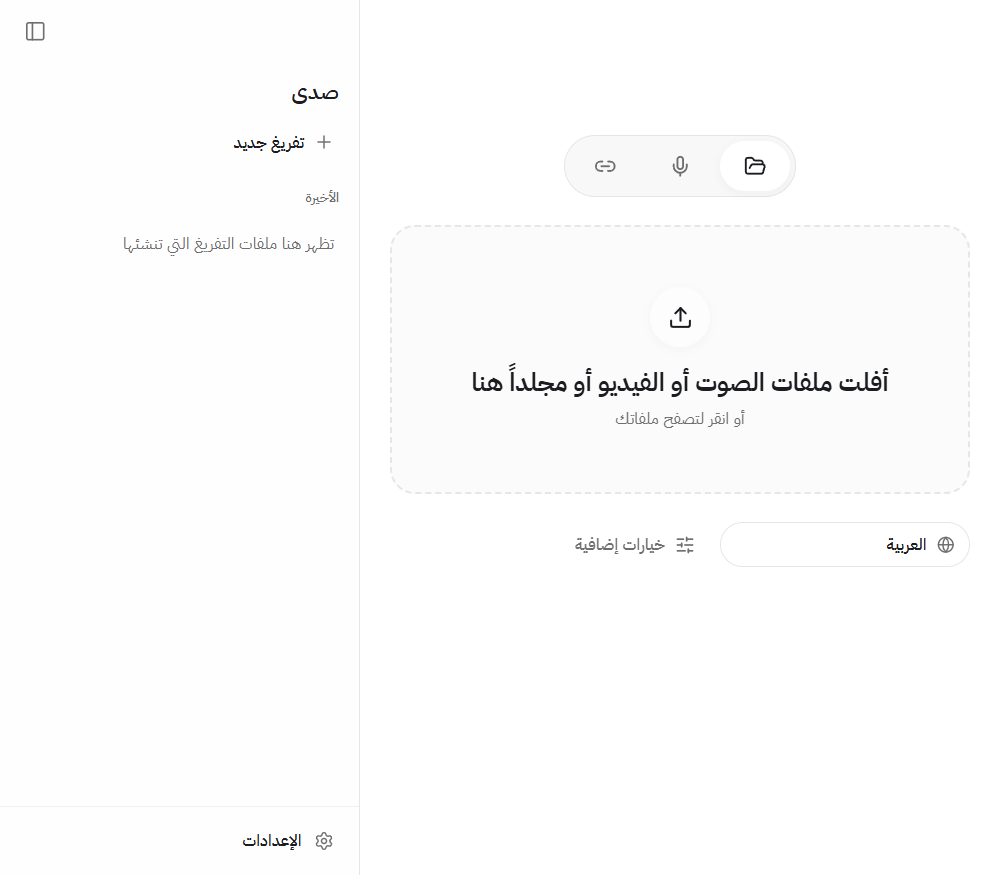
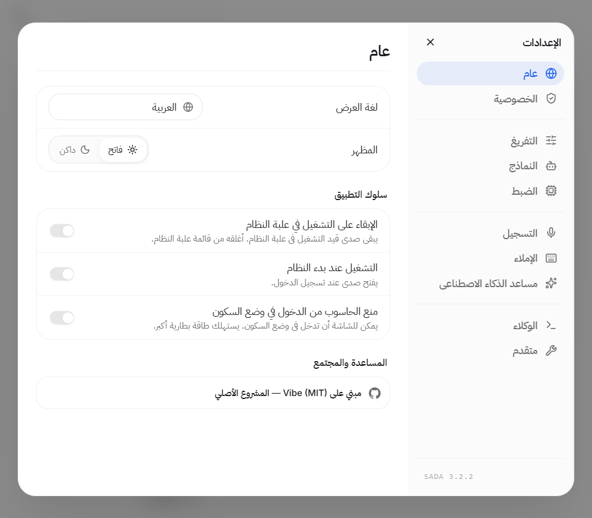
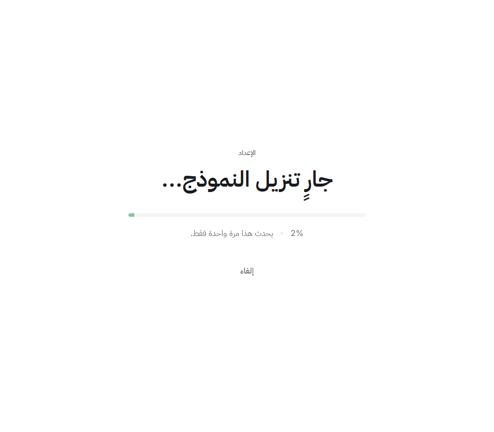

<!--
  README for Sada (صدى) — the GitHub landing page. Arabic counterpart: README.ar.md.
  Keep both files in sync when facts change (version, counts, model list, links).
-->

<div align="center">

# صدى · Sada

**Arabic-first speech-to-text for Windows — free, private and fully offline.**

[](https://github.com/alshahia/sada/actions/workflows/ci.yml)
[](https://github.com/alshahia/sada/releases/latest)


[العربية (Arabic)](README.ar.md) · [Download](https://github.com/alshahia/sada/releases/latest) · [Website](https://alshahia.github.io/sada/en/) · [Documentation](#documentation) · [Verified release](#verified-build-and-release-evidence)

</div>

Sada (صدى, "echo") turns Arabic audio and video into text **on your own Windows PC**, with no
account, no cloud upload and no telemetry. Drop in a file or record a meeting and get a transcript,
subtitles or an Arabic-styled PDF; optional speaker labels, subtitle timing, a vocabulary prompt,
auto-export and URL import are built in. The app opens in Arabic and right-to-left by default, and
English plus the other upstream languages are one click away. It is free, MIT-licensed, and runs
after a one-time model download even with the network cable unplugged.

It is an independent fork of [Vibe](https://github.com/thewh1teagle/vibe) (MIT) on upstream tag
**v3.2.2**, with telemetry, the auto-updater and the phone relay removed, a complete Arabic
localization added, and a local MCP server since 3.3.0 so AI agents can use it without a port or an
account.

> **New in 3.11.0:** a maintenance release, not a feature release — twenty dependency updates
> (Rust, npm and GitHub Actions) plus utoipa 6, a CI job that now builds and tests the engine on
> every change, and a stronger release chain (the engine reports `v0.6.16-sada.2`, and
> `SHA256SUMS.txt` is covered by the build-provenance attestations). No UI, engine, model or
> feature change; the five-user Arabic gate is still the next UX step. See the
> [release notes](https://github.com/alshahia/sada/releases/tag/v3.11.0).

## What makes Sada Arabic-first

Most transcription tools treat Arabic as a translation target or an afterthought. Sada is built the
other way around:

- **Arabic defaults, not English defaults.** The interface starts in `ar-IQ`, transcription in
  `ar`, translation off, temperature 0, beam size 5, six threads and an empty initial prompt.
- **A real RTL interface.** The shell, settings, dialogs, PDF export and error messages are Arabic
  and right-to-left; Latin acronyms, file paths and numbers stay isolated and readable.
- **Arabic-aware transcript cleanup.** ASCII punctuation becomes Arabic (`, → ،`, `? → ؟`,
  `; → ؛`), stray spaces collapse, and common Latin acronyms (GPU, CPU, PDF, SRT, VTT, JSON, API,
  FFmpeg, Whisper) are restored inside Arabic transcripts.
- **Arabic PDF export.** Transcripts export to PDF with an embedded Arabic font and correct
  shaping, not boxes or broken letters.
- **Arabic measured, not assumed.** The model catalogue is backed by a committed Arabic benchmark
  harness (see [quality](#arabic-transcription-quality-measured)); the default is the model that
  actually won on measured Arabic WER, Latin-name retention and timestamps.

## Who Sada is for

- Editors and creators who need Arabic subtitles (SRT/VTT) or a readable transcript without
  uploading client footage.
- Researchers, journalists and students transcribing interviews, lectures and meetings that cannot
  leave the machine.
- Teams on locked-down or intermittent networks, and organisations with data-residency rules.
- Arabic-speaking users who want dictation or file transcription without a subscription.
- Developers who need local Arabic ASR for agents and pipelines through the built-in MCP server.

## Features

| | |
| --- | --- |
| **Transcribe files** | Drop audio or video; batch transcription with per-file progress and cancellation. |
| **Live preview** | Watch the transcript fill in while the file is being processed. |
| **Whisper models** | Any `ggml-*.bin` Whisper model; download from Settings or point at a local file. Recommended for Arabic: `large-v3-turbo`. |
| **Export** | SRT, VTT, TXT, HTML, PDF (embedded Arabic font), DOCX and JSON. |
| **Dictation** | A global shortcut: hold to record, release to transcribe into the active app. |
| **Recording and meetings** | Microphone and system-audio capture. Optional meeting detection notices a call using the microphone and asks whether to record it; optional auto-transcribe turns the finished recording into a transcript as soon as it ends. Both are off by default. |
| **Speaker labels** | Optional speaker diarization adds the speaker to each sentence — up to four speakers, with a recognition threshold and an expected-speaker count. Needs a one-time ~25 MB model download; off by default. |
| **Subtitle timing** | An optional stable-timestamps mode for tighter subtitle timing (about 4× slower); needs a one-time ~1 MB VAD model download. |
| **Custom vocabulary** | A custom initial prompt of up to 1,024 characters biases recognition toward your names, jargon and spellings; models without prompt support ignore it. |
| **Auto-export** | Every finished transcript can be exported automatically to the formats you choose — beside the recording, in the projects folder or in a folder you pick — with an optional replace rule. |
| **Import from a link** | Paste a media URL; Sada downloads the audio locally with yt-dlp (installed or updated only when you agree) and transcribes it. |
| **Projects** | Saved transcripts with search, reopen and re-export. |
| **Translation** | Whisper’s Translate to English, with medium/large models only (not large-v3-turbo); with Claude or a local Ollama model configured, AI tasks can translate as well. |
| **Optional AI** | Claude or a local Ollama model with your own key — summaries, notes, translation and dictation cleanup; off by default. |
| **Agents (MCP)** | `Sada.exe --mcp` exposes four stdio tools to Claude Code, Codex and other MCP clients; Arabic defaults, local only. |
| **Languages** | Arabic (`ar-IQ`) plus 22 inherited interface locales; transcription covers the languages the engine supports. |
| **GPU acceleration** | Optional Vulkan path, with automatic CPU fallback when a model does not fit on the GPU. |
| **Managed controls** | Machine-wide offline policy, DPAPI-sealed API keys and transcript retention for managed installs. |

## Screenshots



| Settings and models | First-run Arabic setup |
| --- | --- |
|  |  |

## Download and install (Windows 10/11 x64)

### Standard installer (recommended)

1. Download **`Sada_3.11.0_x64-setup.exe`** (about 45 MB) from the
   [latest release](https://github.com/alshahia/sada/releases/latest).
2. Verify it (recommended — see [verify the download](#verify-the-download)).
3. Run the installer. It installs per-user into `%LOCALAPPDATA%\Sada\`; no administrator
   rights are required.
4. Launch **صدى / Sada** from the Start Menu.

### Fully offline installer

A Windows 10 machine that has never run a modern app does not have the WebView2 Runtime, and the
standard installer asks Windows to download it. If the target machine cannot go online, download
**`Sada_3.11.0_x64-setup-offline.exe`** (about 250 MB) instead: it embeds the WebView2 installer,
so one file covers both the app and the runtime.

Neither file embeds the VC++ 2015-2022 runtime: the installer fetches it from Microsoft when it is
missing, so a completely offline machine should have `vc_redist.x64.exe` pre-installed
(installing WebView2 first also pulls its dependencies).

### Managed per-machine installer

v3.11.0 also publishes **`Sada_3.11.0_x64_en-US.msi`**, a per-machine WiX installer for
Intune/SCCM/GPO (administrator rights required), with machine-wide policy that can enforce offline
mode and disable AI, URL import and model downloads. Silent install, detection, policy and cleanup
are documented in [docs/ENTERPRISE-DEPLOYMENT.md](docs/ENTERPRISE-DEPLOYMENT.md).

### Verify the download

Every release publishes `SHA256SUMS.txt`, keyless build provenance (Sigstore) and a CycloneDX
SBOM. The short version:

```powershell
# 1. Checksum against the published SHA-256
Get-FileHash .\Sada_3.11.0_x64-setup.exe -Algorithm SHA256

# 2. Build provenance — GitHub CLI verifies the signature and the workflow identity
gh attestation verify .\Sada_3.11.0_x64-setup.exe --repo alshahia/sada

# ...or verify every asset of a release and its hashes in one command
pwsh -File scripts/verify-release.ps1 -Version 3.11.0 -Download
```

Full details: [docs/SUPPLY-CHAIN.md](docs/SUPPLY-CHAIN.md) and
[docs/VERIFICATION.md](docs/VERIFICATION.md).

> **SmartScreen:** the installer is not code-signed yet (an owner decision while the project is
> open-source-only), so Windows may show *"Windows protected your PC"*. Choose *More info → Run
> anyway* only for the official release after verifying the checksum and provenance. Signing is
> staged and will be switched on when the project applies for it — see
> [docs/SIGNING.md](docs/SIGNING.md).

### Requirements

- Windows 10 or Windows 11, 64-bit (x64).
- WebView2 Runtime (bundled with current Windows; the offline installer includes it).
- VC++ 2015-2022 runtime (installed automatically when online).
- Disk space for a Whisper model — about 1.6 GB for the recommended model (models are not bundled).

## First run: choose a model

On first launch Sada opens an Arabic setup screen. Open **Settings → Models → Get models**. The
catalogue ships inside the app, so it works on a fresh offline install, and every download is
checked against the SHA-256 in the catalogue before it is used:

| Model | Size | Licence | Why choose it |
| --- | ---: | --- | --- |
| **Whisper Large v3 Turbo** — default | 1.62 GB | MIT | Best measured Arabic balance: 19.46% WER, word timestamps, keeps a quarter of Latin names. |
| **Whisper Tiny** | 78 MB | MIT | Runs on very slow machines, lower accuracy (only as a fallback). |
| **NVIDIA Nemotron 3.5 ASR Streaming 0.6B** — optional | 496 MB | OpenMDW-1.1 | Faster dictation and lower WER on MSA/Egyptian, but transliterates Latin terms; not the default. |
| **Whisper Large v3 Turbo Hebrew** | 1.62 GB | Apache-2.0 | Hebrew audio (ivrit.ai). |

You can also use **Add a model…** to point at any local `ggml-*.bin` file. Models are downloaded
once, loaded locally and never leave the machine. Sizes, hashes, GPU notes and verification steps:
[docs/MODELS.md](docs/MODELS.md). The measured comparison behind the catalogue:
[docs/MODELS-DECISIONS.md](docs/MODELS-DECISIONS.md).

## Arabic transcription quality (measured)

Sada is not benchmarked by vibes. The repository includes a Python Arabic ASR harness
(`benchmarks/arabic-asr/`) that fetches licence-compatible corpora once, normalizes Arabic, and
scores corpus-level WER/CER, Latin-name retention and word-timestamp coverage. Results on 60 clips
of **Common Voice 18 Arabic** (30 MSA + 10 Latin-mixed read speech) and **FLEURS ar_eg**
(20 Egyptian clips), Vulkan GPU, 2026-11-18, engine `vibe-server v0.6.16-sada.1`:

| Model | WER % ↓ | CER % ↓ | Latin names kept % ↑ | Timestamps % | RTF ↓ |
| --- | ---: | ---: | ---: | ---: | ---: |
| **whisper-large-v3-turbo** (default) | 19.46 | 8.34 | **25.0** | 100.0 | 0.35 |
| nemotron-3.5-asr-streaming-0.6b | **17.12** | 8.28 | 0.0 | 100.0 | **0.234** |
| whisper-large-v3-turbo-arabic-dialectal-v2-q5 | 23.09 | 9.53 | 0.0 | 100.0 | 0.265 |
| whisper-tiny | 70.56 | 29.46 | 0.0 | 100.0 | 0.186 |

Lower WER/CER/RTF is better; higher Latin-name retention is better. WER by slice: MSA 22.09 /
Egyptian 11.03 / Latin-mixed 48.96 for Turbo; Nemotron 17.83 / 9.11 / 50.00. **Not measured yet,
and not claimed:** Iraqi, Gulf and Levantine dialects need a corpus with a commercial-use licence,
which the project has not found; that gap is recorded rather than hidden. Raw results and the
harness: [`benchmarks/arabic-asr/`](benchmarks/arabic-asr/).

## Use Sada from an AI agent (MCP)

`Sada.exe --mcp` starts a local MCP server over stdio — no port, no account, no network. Four
tools: `sada_transcribe` (transcribe a file), `sada_transcripts` (list saved transcripts),
`sada_transcript` (read one) and `sada_info` (install and model info).

```powershell
claude mcp add sada -- "C:\Users\<you>\AppData\Local\Sada\Sada.exe" --mcp
```

Any MCP client can use the equivalent JSON:

```json
{
  "mcpServers": {
    "sada": {
      "command": "C:\\Users\\<you>\\AppData\\Local\\Sada\\Sada.exe",
      "args": ["--mcp"]
    }
  }
}
```

See [docs/AGENT-MCP.md](docs/AGENT-MCP.md) for tool schemas, limits and examples in Arabic and
English.

## GPU acceleration (optional)

Sada ships the Vulkan build of its whisper.cpp engine; a Vulkan 1.1+ GPU (current NVIDIA, AMD or
Intel drivers) can speed up transcription without CUDA or ROCm. GPU is an optional accelerator:
every model still runs on the CPU, and the app does not refuse to start without Vulkan.

- **Settings → Models → Hardware** offers *Auto*, a specific Vulkan device, or *Transcribe on CPU*.
- If a model fails to load on the GPU, Sada retries it on the CPU, tells you, and remembers that
  model so later runs start on the CPU instead of failing again.
- Reference speed: on an NVIDIA Quadro RTX 4000 with Vulkan, 38 seconds of Arabic audio transcribed
  in about 4.9 seconds including model load (~12.5× realtime).
- Diagnostics: `vibe-server-x86_64-pc-windows-msvc.exe devices`; troubleshooting in
  [docs/DEBUG.md](docs/DEBUG.md) and [docs/BUILDING.md](docs/BUILDING.md).

## Enterprise and managed deployment

v3.9.0 adds the controls a managed Windows environment needs, without a server component:

- **Per-machine MSI** for Intune/SCCM/GPO, plus a clean-machine acceptance kit.
- **Managed policy** in `HKLM\SOFTWARE\Sada\Policy` (or `%ProgramData%\Sada\policy.json`)
  that can force offline mode and disable AI, URL import and model downloads; enforced in the Rust
  command layer, not just hidden in the UI.
- **DPAPI-sealed API keys**, **transcript retention/purge**, and a **network egress inventory**.
- **Keyless supply chain:** build provenance attestations, a CycloneDX SBOM (1,939 components) and
  `scripts/verify-release.ps1`.

Start with [docs/ENTERPRISE-DEPLOYMENT.md](docs/ENTERPRISE-DEPLOYMENT.md); the policy, egress,
security and procurement material is listed under [documentation](#documentation).

## Privacy and network

- No analytics, telemetry, crash reporting, account or auto-update.
- Audio, video and transcripts never leave the computer.
- Network is used only for actions *you* start: downloading a model, importing from a media URL
  with yt-dlp, or a summary provider you configure with your own key — and a managed policy can
  forbid all of them.
- The bundled FFmpeg runs as a local subprocess for decoding only.
- Settings and projects live in `%APPDATA%\app.sada.desktop\`; the model and WebView profile
  in `%LOCALAPPDATA%\app.sada.desktop\`.

See [PRIVACY.md](PRIVACY.md) and the complete egress list in [docs/NETWORK.md](docs/NETWORK.md).
The upstream updater and Aptabase client were removed from the source, not switched off at runtime.

## Verified build and release evidence

Every release is built from this repository by GitHub Actions and then verified end-to-end:

- 34 frontend test files / 207 tests, 120 Rust tests, 8 engine guard tests and 62 Python benchmark
  tests pass in CI; `tsc` and the production build are clean.
- The v3.9.0 release run built the engine from `server/`, then the guarded offline NSIS
  installer, the per-machine MSI and the default NSIS installer, generated the SBOM, and signed
  provenance attestations for every asset.
- The published assets were downloaded again and checked with `scripts/verify-release.ps1`:
  SHA-256 matches, `gh attestation verify` succeeds, and both installers install and launch
  with the version and engine expected.
- Arabic transcription, MCP protocol, RTL first-run and idle-network behaviour were verified with
  the app's own engine and a real model.

Evidence: [docs/VERIFICATION.md](docs/VERIFICATION.md) · [acceptance matrix](docs/ACCEPTANCE.md) ·
[production-readiness statement](docs/PRODUCTION-READINESS.md) ·
[v3.11.0 release](https://github.com/alshahia/sada/releases/tag/v3.11.0).

## How Sada compares

| | Cloud transcription services | Upstream Vibe (v3.2.2) | **Sada** |
| --- | --- | --- | --- |
| Audio leaves your device | Yes, by design | No | **No** |
| Account / subscription | Usually | No | **No** |
| Works offline | No | Yes, after a model download | **Yes, after a model download** |
| Arabic-first UI and defaults | Rarely | No (English-first) | **Yes (ar-IQ, RTL, Arabic PDF)** |
| Telemetry and auto-update | Typically | Present upstream | **Removed from the source** |
| Price | Subscription | Free (MIT) | **Free (MIT)** |
| Agent access | Vendor API | — | **Local MCP server** |

Comparisons are about the design each project ships, not a claim that cloud services are bad; cloud
services are a better fit when you need elastic scale, many languages or shared team infrastructure.

## Documentation

| Start here | Models and quality | Privacy and security | Enterprise | Development |
| --- | --- | --- | --- | --- |
| [Install and first run](README.md#first-run-choose-a-model) | [Models and hashes](docs/MODELS.md) | [Privacy policy](PRIVACY.md) | [Enterprise deployment](docs/ENTERPRISE-DEPLOYMENT.md) | [Building from source](docs/BUILDING.md) |
| [Agent/MCP guide](docs/AGENT-MCP.md) | [Model decisions](docs/MODELS-DECISIONS.md) | [Network egress](docs/NETWORK.md) | [Managed policy and egress](docs/NETWORK.md) | [Architecture](docs/ARCHITECTURE.md) |
| [Verification report](docs/VERIFICATION.md) | [Arabic benchmark](benchmarks/arabic-asr/) | [Security whitepaper](docs/SECURITY-WHITEPAPER.md) | [Supply chain](docs/SUPPLY-CHAIN.md) | [Upstream patches](docs/UPSTREAM-PATCHES.md) |
| [Release notes](docs/releases/v3.11.0.md) | [GPU notes](docs/DEBUG.md) | [Threat model](docs/THREAT-MODEL.md) | [Signing plan](docs/SIGNING.md) | [Contributing](CONTRIBUTING.md) |

Maintainer material: [discoverability and SEO plan](docs/DISCOVERABILITY.md), [release verification runbook](docs/VALIDATION-RUNBOOK.md), [acceptance matrix](docs/ACCEPTANCE.md), [UI/UX review and council verdict](docs/UI-UX-REVIEW.md), [features council](docs/FEATURES-COUNCIL.md) and [P7 plan](docs/P7-PLAN.md).

Arabic documentation: [README.ar.md](README.ar.md), [Network](docs/NETWORK.ar.md),
[models](docs/MODELS.ar.md), [MCP](docs/AGENT-MCP.ar.md).

## Build from source

Prerequisites: [Rust](https://rustup.rs), Node.js 22+, pnpm 10.4.1 (corepack) and
[chore](https://getchore.github.io/chore/).

```powershell
git clone https://github.com/alshahia/sada.git
cd sada
chore setup x86_64-pc-windows-msvc   # downloads the pinned vibe-server + ffmpeg sidecars
cd desktop
pnpm install
pnpm test
pnpm exec tauri build                # writes the NSIS installer under target/release/bundle/nsis/
```

Sidecar binaries are not committed to git (they are ~175 MB combined); `chore setup` fetches the
pinned release from the upstream server tag in [.server-version](.server-version). See
[docs/BUILDING.md](docs/BUILDING.md) for details and non-Windows instructions.

## Repository layout

```text
desktop/          React 19 + Tauri 2 desktop app (frontend, Rust shell, icons, fonts)
i18n/desktop/     Translation catalogues, including ar-IQ.json (748 keys)
server/           vibe-server: Rust sidecar around whisper.cpp (upstream engine)
benchmarks/       Arabic ASR benchmark harness and committed results
docs/             Architecture, building, verification, licences, release notes, MCP, assurance pack
site/             Bilingual static landing page (GitHub Pages, with llms.txt for agents)
scripts/          Release verification, SBOM generation, enterprise and acceptance helpers
.github/workflows CI (build + tests), Release (tag → installers + provenance), Security, Deploy site
```

## FAQ

<details>
<summary><strong>Is Sada free?</strong></summary>
Yes. MIT-licensed source and a free Windows installer — no account, no subscription, no ads.
</details>

<details>
<summary><strong>Does it work without internet?</strong></summary>
Yes, after the one-time model download. Transcription is fully local; the network is used only for
actions you explicitly request.
</details>

<details>
<summary><strong>What are the system requirements?</strong></summary>
64-bit Windows 10 or 11, the WebView2 Runtime, the VC++ 2015-2022 runtime, and disk space for a
Whisper model (~1.6 GB for the recommended one). The offline installer embeds WebView2.
</details>

<details>
<summary><strong>Do I need a GPU?</strong></summary>
No. GPU is an optional Vulkan accelerator; every model runs on the CPU, and Sada retries on the CPU
automatically when a model does not fit on the GPU.
</details>

<details>
<summary><strong>Does it support Iraqi Arabic?</strong></summary>
Whisper handles Iraqi Arabic as part of Arabic, and the Arabic cleanup normalizes punctuation.
Accuracy depends on the model and the audio; `large-v3-turbo` is the recommended starting point.
No published Iraqi benchmark exists yet because no corpus with a commercial-use licence was
available — that limitation is recorded, not hidden.
</details>

<details>
<summary><strong>Which languages are supported?</strong></summary>
Arabic (`ar-IQ`) is the first-class language; the interface also ships 22 inherited locales, and
transcription covers the languages the Whisper engine supports. English is one click away.
</details>

<details>
<summary><strong>What formats can I export?</strong></summary>
SRT, VTT, TXT, HTML, PDF (embedded Arabic font), DOCX and JSON.
</details>

<details>
<summary><strong>Can AI agents use Sada?</strong></summary>
Yes. `Sada.exe --mcp` is a local MCP server over stdio with four tools: transcribe a file, list
saved transcripts, read one transcript and report install info. Register it in Claude Code with
`claude mcp add sada -- "...\Sada.exe" --mcp` or in any MCP client JSON config. It is local
only: no port, no account, no network.
</details>

<details>
<summary><strong>How is Sada different from Vibe?</strong></summary>
Sada is a fork of Vibe v3.2.2: full Arabic localization and RTL, Arabic defaults and transcript
cleanup, Arabic PDF export, a new name and icon, and removal of telemetry, auto-update and the phone
relay. The transcription engine is upstream code; patches are listed in
[docs/UPSTREAM-PATCHES.md](docs/UPSTREAM-PATCHES.md).
</details>

<details>
<summary><strong>Why does Windows warn about the installer?</strong></summary>
The installer is not code-signed yet (code-signing certificates cost money). Verify the SHA-256
checksum and build provenance, or build from source. Signing is staged and not switched on — see
[docs/SIGNING.md](docs/SIGNING.md).
</details>

<details>
<summary><strong>Where are my files?</strong></summary>
Settings, logs and projects: `%APPDATA%\app.sada.desktop\`. Model and WebView data:
`%LOCALAPPDATA%\app.sada.desktop\`. Nothing is copied elsewhere.
</details>

<details>
<summary><strong>Can I use it commercially?</strong></summary>
Yes — the MIT licence permits commercial use of the source. The installer bundles an FFmpeg 9.0.2
GPLv3 build; read [THIRD-PARTY-NOTICES.md](THIRD-PARTY-NOTICES.md) before redistributing a build.
</details>

## Contributing

Issues and pull requests are welcome — see [CONTRIBUTING.md](CONTRIBUTING.md). For security reports
use GitHub Security Advisories, see [SECURITY.md](SECURITY.md). If Sada saves you time, a star helps
other Arabic users find it: [github.com/alshahia/sada](https://github.com/alshahia/sada).

## Licence and attribution

MIT — see [LICENSE](LICENSE). The original Vibe copyright notice is preserved. Sada is an
independent fork, **not affiliated with or endorsed by** the Vibe author; "Vibe" remains that
author's property, while the Sada name and artwork are this fork's own.

The installer bundles an **FFmpeg 9.0.2 GPLv3** build; read
[THIRD-PARTY-NOTICES.md](THIRD-PARTY-NOTICES.md) before redistributing a build. IBM Plex Sans Arabic
is SIL OFL 1.1. Full notices and licence texts: [NOTICE](NOTICE), [docs/licenses/](docs/licenses/).

---

<sub>صدى — تفريغ صوتي عربي على جهازك، بلا إنترنت. Arabic-first offline transcription for Windows.</sub>
